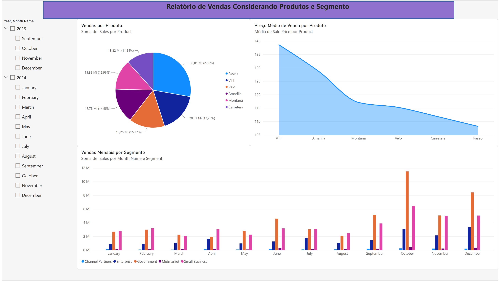
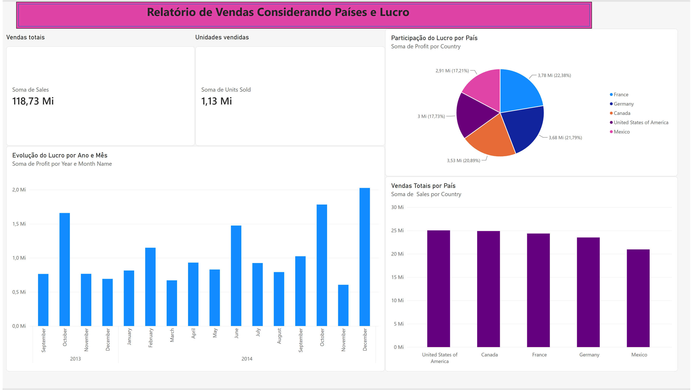
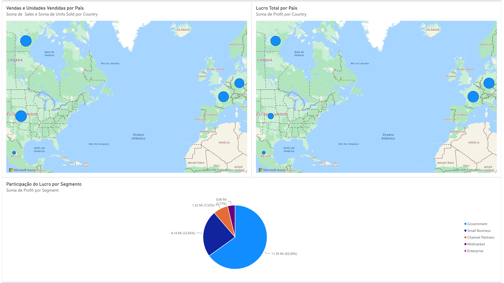

#  Análise Financeira e de Vendas com Power BI

##  Sobre o projeto

Projeto desenvolvido como parte do desafio prático **Analisando Dados de um Dashboard de Vendas no Power BI**, da plataforma DIO.

O objetivo foi construir relatórios interativos para analisar o desempenho comercial e financeiro de uma base de dados de exemplo, explorando indicadores de vendas, lucratividade, produtos, segmentos e países.

##  Objetivos

- Analisar o volume de vendas e o desempenho financeiro.
- Comparar os resultados por produto e segmento.
- Identificar a distribuição geográfica de vendas e lucros.
- Apresentar indicadores de forma clara e visual.
- Desenvolver habilidades práticas de Business Intelligence.

##  Ferramentas utilizadas

- **Microsoft Power BI Desktop:** construção dos relatórios.
- **Power BI Service:** publicação do projeto.
- **Microsoft Excel:** fonte de dados Financial Sample.
- **Microsoft PowerPoint:** apresentação dos dashboards.
- **GitHub:** documentação e versionamento do projeto.

##  Estrutura dos dashboards

### Página 1 — Vendas por Produtos e Segmentos

Apresenta análises de vendas por produto, preço médio de venda e evolução mensal das vendas por segmento, incluindo filtros de período.

### Página 2 — Vendas por Países e Lucro

Apresenta indicadores de vendas totais e unidades vendidas, participação do lucro por país, evolução mensal do lucro e comparação das vendas entre países.

### Página 3 — Análise Geográfica e Lucro

Contém três visualizações principais:

1. Mapa de vendas e unidades vendidas por país.
2. Mapa do lucro total por país.
3. Gráfico de pizza com a participação do lucro por segmento.

##  Arquivos do repositório

- `Desafio_DIO_Power_BI_BACKUP.pbix` — relatório editável do Power BI.
- `Desafio_DIO_Power_BI_BACKUP.pptx` — apresentação dos dashboards.
- `README.md` — documentação do projeto.

##  Conhecimentos aplicados

Importação de dados, configuração de visualizações, utilização de filtros, análise de indicadores financeiros, organização de dashboards, publicação de relatórios e documentação técnica.

##  Resultado

O projeto reúne três páginas de análise interativa, permitindo explorar informações comerciais e financeiras de diferentes perspectivas.

Esta entrega integra meu portfólio de projetos práticos em **Análise de Dados e Business Intelligence**.

##  Formação

Desafio prático realizado na plataforma **DIO — Digital Innovation One**, durante os estudos de Power BI.

---

**Projeto desenvolvido para fins educacionais e de aprimoramento profissional.**

## 📸 Visualização dos Dashboards

### Dashboard 1 — Vendas por Produtos e Segmentos

### Dashboard 2 — Vendas por Países e Lucro

### Dashboard 3 — Análise Geográfica e Lucro

